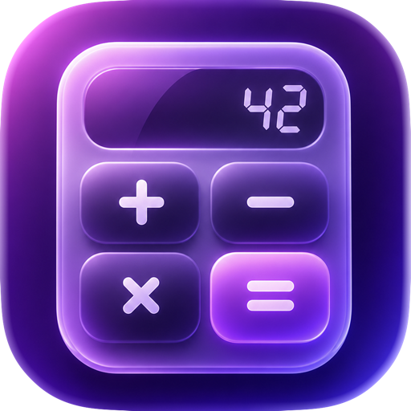
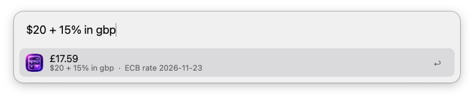
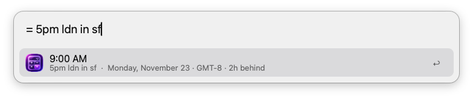
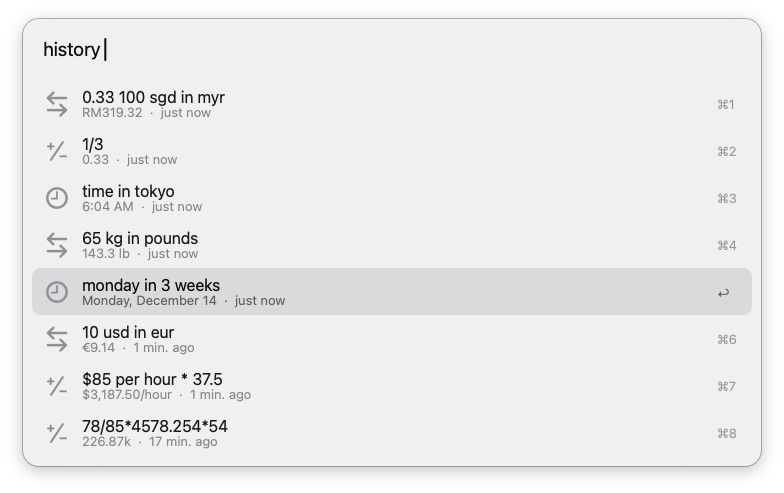
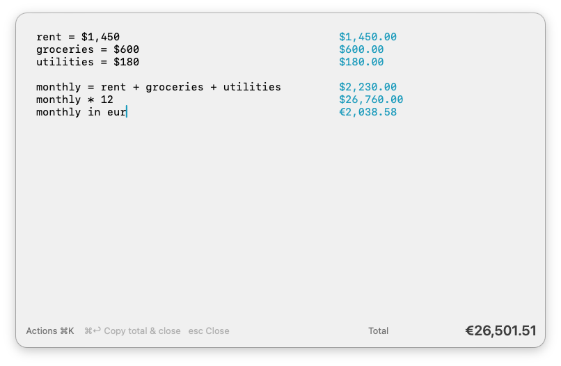
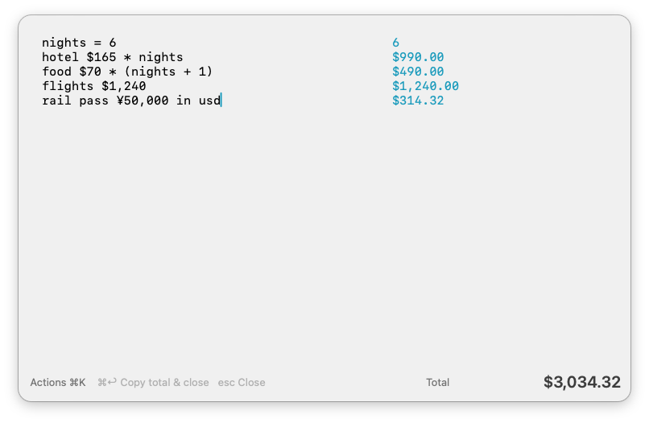
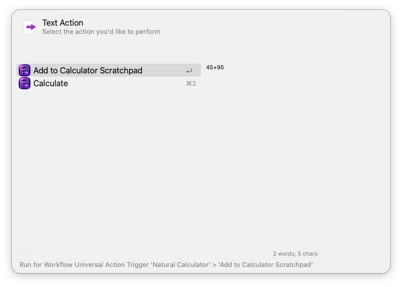

#  Natural Calculator Alfred Workflow

**One calculator. Almost anything. Right inside Alfred.**

Calculate, convert currencies and units, work with dates and time zones, and build multi-line calculations, all in plain English. Powered by SoulverCore, with nothing else to install.

Alfred 6 · macOS 13.5+ · Apple silicon

[⤓ Download the latest release](https://github.com/alwinsamson/natural-calculator-workflow/releases/latest)

https://github.com/user-attachments/assets/6c1ed029-f9ee-45b7-9194-c59e2bf59c10

## Install

1. Download `NaturalCalculator.alfredworkflow` from the [latest release](https://github.com/alwinsamson/natural-calculator-workflow/releases/latest).
2. Double-click it to install in Alfred.
3. Optional: turn off Alfred's own calculator to avoid duplicate results (see [Configuration](#configuration)).

If macOS blocks the bundled program the first time it runs, allow it in System Settings → Privacy & Security → *Open Anyway* (see [Compatibility](#compatibility)).

## Usage

Calculate maths, units, currencies, dates and time zones in plain English. Start typing with a number or `$` `€` `£` `(` `.` `-` and the answer appears, no keyword needed.



* <kbd>↩</kbd> Copy the result.
* <kbd>⌘</kbd><kbd>↩</kbd> Copy the unformatted value.
* <kbd>⌥</kbd><kbd>↩</kbd> Paste the result into the frontmost app.
* <kbd>⌃</kbd><kbd>↩</kbd> Show more actions.
* <kbd>⇧</kbd><kbd>↩</kbd> Put the result back in Alfred to keep calculating.
* <kbd>⌘</kbd><kbd>L</kbd> Show the result in Large Type.

Calculate things that start with a word, like dates and time zones, via the `=` keyword. The subtitle explains the answer: where an exchange rate came from, the weekday and GMT offset for a time, or how many days away a date is.



Search past calculations, or type a new one, via the `history` keyword. Results you copy or paste are saved.



<kbd>⌃</kbd><kbd>↩</kbd> on any result shows more actions: copy the question or the question and answer, paste, put the answer or the question back in the search bar, or remove it from history.


Work through multi-line calculations via the `calc` keyword. Name a value and reuse it on later lines; every line gets a result and the total adds up as you type.



* <kbd>⌘</kbd><kbd>K</kbd> Copy the total, the results, or every line with its result, or clear the scratchpad.
* <kbd>⌘</kbd><kbd>↩</kbd> Copy the total and close.

Lines can be plain labels, and currencies convert on the way into the total.



Alternatively, calculate selected text or add it to the scratchpad via the [Universal Action](https://www.alfredapp.com/help/features/universal-actions/).



## Configuration

Open the workflow in Alfred Preferences and click *Configure Workflow* ([Workflow’s Configuration](https://www.alfredapp.com/help/workflows/user-configuration/)).

| Setting | Default |
|---|---|
| Word query keyword | `=` |
| History keyword | `history` |
| Scratchpad keyword | `calc` |
| Calculate without a keyword (digits, `$`, `€`, `£`, `(`, `.`, `-`) | On |
| Save calculations I copy or paste | On |
| Decimal places | 2 |
| Thousands separator | On |
| Currency rate refresh | Every 6 hours |

To avoid duplicate results, turn off Alfred's own calculator in Alfred Preferences → Features → Calculator: uncheck *Enable standard calculator* and *Enable advanced calculator with keyword '='*. The advanced one uses the same `=` keyword as word queries here.

## Currency Rates

* **Most currencies** use European Central Bank reference rates (about 30 currencies), fetched in the background and cached. The ECB publishes once per working day; the subtitle shows the date of the rate used, e.g. *ECB rate 2026-11-23*.
* **Crypto and currencies the ECB doesn't publish** use fixed rates built into SoulverCore. They never update, so treat them as approximate. Results that use them say so in the subtitle, e.g. *built-in BTC rate (may be outdated)*.
* **Offline**, the last cached ECB rates are used. Before the first fetch, the built-in rates are used.

## Compatibility

| | |
|---|---|
| **Alfred** | Alfred 6 with the [Powerpack](https://www.alfredapp.com/powerpack/). The scratchpad uses Alfred UI, which is new in Alfred 6. |
| **macOS** | macOS 13.5 Ventura or later (SoulverCore's minimum). Tested on macOS 26. |
| **Mac** | Apple silicon only for now. Intel Macs are not supported yet. |
| **Internet** | Optional. Used only to fetch European Central Bank rates in the background; everything else works offline, with cached or built-in rates for currency. |
| **Security** | The bundled program is not yet signed and notarised by Apple. If macOS blocks it the first time, allow it in System Settings → Privacy & Security → *Open Anyway*. |

Nothing else to install: SoulverCore is bundled in the workflow. You don't need the Soulver app, Xcode, or Homebrew.

## Building from Source

Needs Apple's Command Line Tools (Swift 6); Xcode isn't required.

```sh
./build.sh
open dist/NaturalCalculator.alfredworkflow
```

`build.sh` compiles `soulvercalc` (downloading SoulverCore on the first run), copies it and SoulverCore into `Workflow/`, generates `Workflow/info.plist`, and zips `Workflow/` into `dist/`. The compiled parts and `dist/` are gitignored; releases carry the packaged workflow.

| Path | Purpose |
|---|---|
| `Sources/soulvercalc/` | The calculator program: `main.swift` (calculation, currency rates, settings, Alfred output), `History.swift`, `Actions.swift`, `Scratchpad.swift` |
| `Workflow/` | The workflow as Alfred sees it: scratchpad UI (`calc.alfredui/`), icons, readme screenshots, generated `info.plist` |
| `assets/workflow_readme.md` | The readme shown in Alfred Preferences, copied into `info.plist` |
| `assets/workflow_layout.json` | Canvas positions from Alfred Preferences. After rearranging the canvas, export the workflow and copy its `uidata` here |
| `tools/make_icons.js` | Draws the history icons from SF Symbols |
| `build.sh` | Build and package |

How it works, briefly:

* **No keyword.** Alfred needs a keyword for every Script Filter, so there is one per leading character (`0`–`9`, `.`, `-`, `(`, `$`, `€`, `£`) with no space after it. Each passes its character back in front of the query.
* **History.** Result rows carry `calc_query`, `calc_result`, `calc_raw` and `calc_kind` as Alfred variables. Copying or pasting runs `soulvercalc --record`, which saves them to `history.json` in the workflow data folder. Typing alone saves nothing.
* **More actions.** <kbd>⌃</kbd><kbd>↩</kbd> stashes the row to a file and opens the actions list through an External Trigger; a Conditional routes each action.
* **Currency.** European Central Bank rates are cached in the workflow data folder and refreshed by a detached `soulvercalc --refresh-rates` when stale, so typing never waits on the network.
* **Scratchpad.** `soulvercalc --pad` evaluates the text with SoulverCore's `LineCollection` (variable declarations on) and returns per-line results, the total, and the text as a persisted Alfred UI variable.

## Licence and Credits

The code in this repository is licensed under the [BSD 3-Clause License](LICENSE).

Releases bundle [SoulverCore](https://github.com/soulverteam/SoulverCore), © Soulver, distributed with Soulver's permission under its non-commercial licence with attribution. SoulverCore is closed source and is not covered by this repository's licence; anyone redistributing builds that include it must follow Soulver's terms.
