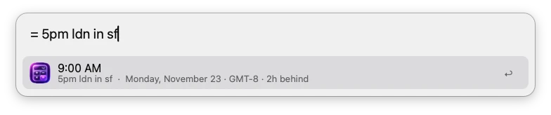
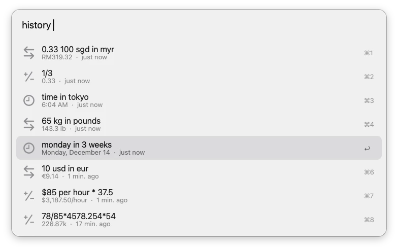
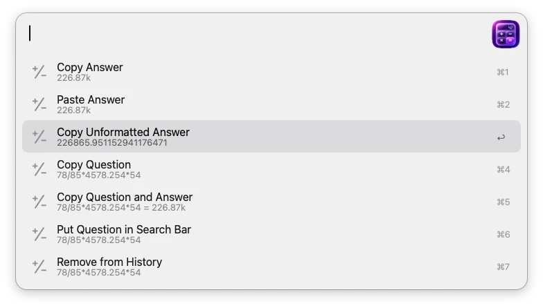

<a name="top"></a>

<p align="center">
  <a href="https://github.com/alwinsamson/natural-calculator-workflow">
    
  </a>
</p>

<h1 align="center">Natural Calculator for Alfred</h1>

<p align="center">
  Calculate math, units, currencies, dates, and time zones in plain English in Alfred.
</p>

<p align="center">
  <a href="https://github.com/alwinsamson/natural-calculator-workflow/issues/new?template=bug_report.yml">
    Report a Bug</a> ·
  <a href="https://github.com/alwinsamson/natural-calculator-workflow/issues/new?template=feature_suggestion.yml">
    Request a Feature</a>
</p>

<details>
<summary>Table of Contents</summary>

- [Overview](#overview)
- [Requirements](#requirements)
- [Installation](#installation)
- [Usage](#usage)
- [Configuration](#configuration)
- [Currency rates](#currency-rates)
- [Building from source](#building-from-source)
- [License](#license)

</details>

---

## Overview

Calculate, convert currencies and units, work with dates and time zones, and build
multi-line calculations, all in plain English. The workflow bundles SoulverCore, so
you do not need to install anything else.

<!-- markdownlint-disable-next-line MD034 -->
https://github.com/user-attachments/assets/6c1ed029-f9ee-45b7-9194-c59e2bf59c10

## Requirements

| Component | Requirement                                                                                                                                                        |
| --------- | ------------------------------------------------------------------------------------------------------------------------------------------------------------------ |
| Alfred    | Alfred 6 with the [Powerpack][powerpack]. The scratchpad uses Alfred UI, which is new in Alfred 6.                                                                 |
| macOS     | macOS 13.5 Ventura or later (the SoulverCore minimum). Tested on macOS 26.                                                                                         |
| Mac       | Apple silicon. Intel Macs are not supported yet.                                                                                                                   |
| Internet  | Optional. The workflow only uses it to fetch European Central Bank rates in the background. Everything else works offline, with cached or built-in currency rates. |

You do not need the Soulver app, Xcode, or Homebrew.

## Installation

1. Download `NaturalCalculator.alfredworkflow` from the [latest release][releases].
2. Open the file. Alfred imports the workflow.
3. Optional: turn off the Alfred calculator to prevent duplicate results. See
   [Configuration](#configuration).

The bundled program is not signed and notarized by Apple yet. If macOS blocks it the
first time it runs, open System Settings → Privacy & Security and click **Open
Anyway**.

## Usage

Calculate math, units, currencies, dates, and time zones in plain English. Start
typing with a number or `$` `€` `£` `(` `.` `-`. The answer appears without a keyword.

<p align="center">
  
</p>

| Key  | Action                                            |
| ---- | ------------------------------------------------- |
| `↩`  | Copy the result                                   |
| `⌘↩` | Copy the unformatted value                        |
| `⌥↩` | Paste the result into the frontmost app           |
| `⌃↩` | Show more actions                                 |
| `⇧↩` | Put the result back in Alfred to keep calculating |
| `⌘L` | Show the result in Large Type                     |

To calculate something that starts with a word, like a date or a time zone, use the
`=` keyword. The subtitle explains the answer: the source of an exchange rate, the
weekday and GMT offset for a time, or the number of days until a date.

<p align="center">
  
</p>

To search past calculations, or type a new one, use the `history` keyword. The
workflow saves the results that you copy or paste.

<p align="center">
  
</p>

Press `⌃↩` on a result to show more actions. You can copy the question, or the
question and answer, paste, put the answer or the question back in the search bar,
or remove the result from history.

<p align="center">
  
</p>

To work through multi-line calculations, use the `calc` keyword. Name a value and use
it again on later lines. Each line gets a result, and the total updates as you type.

<p align="center">
  
</p>

| Key  | Action                                                                             |
| ---- | ---------------------------------------------------------------------------------- |
| `⌘K` | Copy the total, the results, or each line with its result, or clear the scratchpad |
| `⌘↩` | Copy the total and close                                                           |

Lines can be plain labels. Currencies convert when they are added to the total.

<p align="center">
  
</p>

You can also calculate selected text, or add it to the scratchpad, with the
[Universal Action][universal-actions].

<p align="center">
  
</p>

## Configuration

In Alfred Preferences, select the workflow and click **Configure Workflow**. See
[Workflow configuration][user-configuration].

| Setting                                                            | Default       |
| ------------------------------------------------------------------ | ------------- |
| Word query keyword                                                 | `=`           |
| History keyword                                                    | `history`     |
| Scratchpad keyword                                                 | `calc`        |
| Calculate without a keyword (digits, `$`, `€`, `£`, `(`, `.`, `-`) | On            |
| Save calculations I copy or paste                                  | On            |
| Decimal places                                                     | 2             |
| Thousands separator                                                | On            |
| Currency rate refresh                                              | Every 6 hours |

To prevent duplicate results, turn off the Alfred calculator. In Alfred Preferences →
Features → Calculator, clear **Enable standard calculator** and **Enable advanced
calculator with keyword '='**. The advanced calculator uses the same `=` keyword as
word queries.

## Currency rates

- **Most currencies** use European Central Bank reference rates for about 30
  currencies. The workflow fetches them in the background and caches them. The ECB
  publishes once per working day. The subtitle shows the date of the rate, for
  example *ECB rate 2026-11-23*.
- **Crypto and currencies that the ECB does not publish** use fixed rates built into
  SoulverCore. These rates never update, so treat them as approximate. The subtitle
  says so, for example *built-in BTC rate (may be outdated)*.
- **Offline**, the workflow uses the last cached ECB rates. Before the first fetch, it
  uses the built-in rates.

## Building from source

The build requires the Apple Command Line Tools (Swift 6). Xcode is not required.

```sh
./build.sh
open dist/NaturalCalculator.alfredworkflow
```

`build.sh` compiles `soulvercalc` and downloads SoulverCore on the first run. It copies
both into `Workflow/`, generates `Workflow/info.plist`, and zips `Workflow/` into
`dist/`. Git ignores the compiled parts and `dist/`. Releases contain the packaged
workflow.

| Path                          | Purpose                                                                                                                                           |
| ----------------------------- | ------------------------------------------------------------------------------------------------------------------------------------------------- |
| `Sources/soulvercalc/`        | The calculator program: `main.swift` (calculation, currency rates, settings, Alfred output), `History.swift`, `Actions.swift`, `Scratchpad.swift` |
| `Workflow/`                   | The workflow as Alfred sees it: scratchpad UI (`calc.alfredui/`), icons, readme screenshots, generated `info.plist`                               |
| `assets/icon_source.png`      | 1024 px original of the workflow icon. `Workflow/icon.png` is a 512 px copy                                                                       |
| `assets/workflow_readme.md`   | The readme shown in Alfred Preferences, copied into `info.plist`                                                                                  |
| `assets/workflow_layout.json` | Canvas positions from Alfred Preferences. After you rearrange the canvas, export the workflow and copy its `uidata` here                          |
| `tools/make_icons.js`         | Draws the history icons from SF Symbols                                                                                                           |
| `build.sh`                    | Builds and packages the workflow                                                                                                                  |

How it works:

- **No keyword.** Alfred needs a keyword for each Script Filter. There is one per
  leading character (`0`–`9`, `.`, `-`, `(`, `$`, `€`, `£`) with no space after it.
  Each passes its character back in front of the query.
- **History.** Result rows carry `calc_query`, `calc_result`, `calc_raw`, and
  `calc_kind` as Alfred variables. Copying or pasting runs `soulvercalc --record`,
  which saves them to `history.json` in the workflow data folder. Typing alone saves
  nothing.
- **More actions.** `⌃↩` stashes the row to a file and opens the actions list through
  an External Trigger. A Conditional routes each action.
- **Currency.** The workflow caches European Central Bank rates in the workflow data
  folder. When they are stale, a detached `soulvercalc --refresh-rates` refreshes
  them, so typing never waits on the network.
- **Scratchpad.** `soulvercalc --pad` evaluates the text with the SoulverCore
  `LineCollection` (variable declarations on). It returns per-line results, the total,
  and the text as a persisted Alfred UI variable.

## License

The code in this repository is available under the BSD 3-Clause license. See
[LICENSE](LICENSE) for details.

Releases bundle [SoulverCore][soulvercore], © Soulver, distributed with permission
from Soulver under its non-commercial license with attribution. SoulverCore is closed
source and is not covered by the license of this repository. Anyone who redistributes
builds that include it must follow the Soulver terms.

---

<p align="right">
  <a href="#top">Back to top</a>
</p>

[releases]: https://github.com/alwinsamson/natural-calculator-workflow/releases/latest
[powerpack]: https://www.alfredapp.com/powerpack/
[universal-actions]: https://www.alfredapp.com/help/features/universal-actions/
[user-configuration]: https://www.alfredapp.com/help/workflows/user-configuration/
[soulvercore]: https://github.com/soulverteam/SoulverCore
